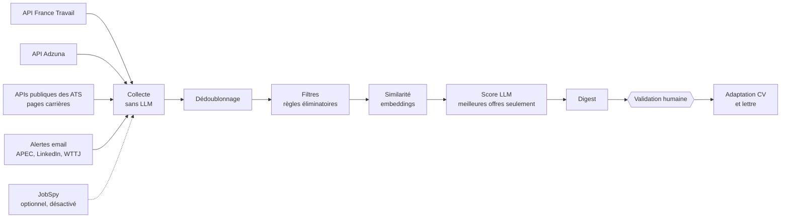

# Vigie

[](https://github.com/HLeviel/vigie/actions/workflows/ci.yml)
[](LICENSE)
[](pyproject.toml)

**Un copilote IA de recherche d'emploi pour le marché français : il surveille les offres et ne signale que celles qui comptent.**

> **English summary.** Vigie is a job-search copilot for the French market, built as a portfolio project. It is a monorepo of four modules: `radar` (daily job collection from official APIs, no LLM), `match` (three-stage offer/CV scoring with a measured evaluation), `cv` (tailored CV and cover letter, shipped as an Agent Skill) and `agent` (a LangChain agent orchestrating the others, with human approval before any action). **Current status: the repository contains the design only; no module is implemented yet.**

## Origine du nom

Dans un navire, la vigie est le marin posté en haut du mât. Elle surveille l'horizon en continu et ne signale que ce qui mérite l'attention du pont. Le projet reprend ce principe : parcourir beaucoup d'offres, n'en remonter que quelques-unes.

## Le problème

Chercher un poste en France oblige à surveiller plusieurs sources (France Travail, APEC, LinkedIn, Welcome to the Jungle, pages carrières des entreprises), à écarter les doublons et les offres hors sujet, puis à adapter son CV à chaque candidature. Ce travail est répétitif et se fait à la main.

Ce qui distingue Vigie des projets existants :

- **France d'abord.** Les sources, les critères (région, télétravail, type de contrat) et la langue sont pensés pour le marché français.
- **Scoring hybride et évalué.** Règles éliminatoires, puis embeddings, puis LLM sur les meilleures offres seulement. La qualité est mesurée (precision@k sur un jeu d'offres annotées), pas supposée.
- **Déploiement serverless.** Collecte planifiée par GitHub Actions, puis migration vers AWS (Lambda, EventBridge, DynamoDB).

## Architecture



La collecte, le dédoublonnage et les filtres appartiennent à `radar`. Les trois étages de score appartiennent à `match`. Le digest est la sortie quotidienne ; l'`agent` orchestre l'ensemble et demande une validation humaine avant toute action.

## Modules

| Module | Rôle | Statut |
|---|---|---|
| `radar` | Veille quotidienne des offres, sans LLM | En cours (modèles et normalisation ; aucune source ni collecte) |
| `match` | Score offre/CV en 3 étages, évaluation precision@k | Prévu |
| `cv` | CV et lettre adaptés, packagés en Agent Skill | Prévu |
| `agent` | Agent LangChain, validation humaine avant action | Prévu |

Aucun module n'est encore fonctionnel : `radar` n'a pour l'instant que son squelette, ses modèles de données et ses fonctions de normalisation (aucune collecte). Ce tableau sera mis à jour à chaque avancée réelle.

## Démarrage rapide

> **Prévu.** Cette section décrit la cible. Le code n'existe pas encore : les commandes ci-dessous ne fonctionneront pas aujourd'hui. Les noms et options peuvent changer.

```bash
git clone https://github.com/HLeviel/vigie.git
cd vigie
uv sync
cp .env.example .env
```

Variables d'environnement (voir [`.env.example`](.env.example)) :

| Variable | Usage |
|---|---|
| `FT_CLIENT_ID`, `FT_CLIENT_SECRET` | API France Travail |
| `ADZUNA_APP_ID`, `ADZUNA_APP_KEY` | API Adzuna (lot M2) |
| `SMTP_HOST`, `SMTP_PORT`, `SMTP_USER`, `SMTP_PASSWORD`, `DIGEST_TO` | Envoi du digest (lot M2) |
| `VIGIE_STATE_BUCKET` | Bucket S3 privé de l'état (lot M2) |
| `VIGIE_RADAR_CONFIG` | Critères de recherche réels, hors dépôt (lot M2) |

Les secrets sont lus uniquement par `src/vigie/settings.py`. Le squelette de ce chargement existe ; le reste de `radar` reste à écrire.

Le lancement (`radar`, puis `match`) sera documenté quand le premier module existera.

## Choix techniques

- **APIs officielles plutôt que scraping.** Stables, autorisées, sans risque de blocage ni de non-conformité aux conditions d'utilisation. JobSpy n'est qu'une option, désactivée par défaut.
- **Pas de LLM à la collecte.** La collecte est déterministe, peu coûteuse et reproductible. Le LLM n'intervient qu'en fin de chaîne, sur un petit nombre d'offres.
- **État stocké hors du cache GitHub Actions.** Le cache peut être évincé ; l'historique des offres vues ne doit pas l'être. L'état vit dans un stockage durable (DynamoDB à terme).
- **Annonces traitées comme entrée potentiellement malveillante.** Le texte d'une offre est une donnée non fiable : il est nettoyé et délimité avant d'atteindre le LLM, pour limiter les injections de prompt.
- **Garde-fou sur le CV.** Aucune ligne générée sans source dans le CV de référence.

## Données personnelles

Le dépôt public utilise uniquement un **profil fictif**. Le vrai CV et les digests restent privés et ne sont jamais committés.

## Compétences mises en œuvre

Python, GitHub Actions, AWS (Lambda, EventBridge, DynamoDB), RAG, embeddings, agents LangChain, Claude Code, Agent Skills, GitHub Copilot.

Ces compétences sont l'objectif du projet ; elles seront démontrées module par module au fil de l'implémentation.

## Feuille de route

1. `radar` : collecte France Travail et Adzuna, dédoublonnage, GitHub Actions.
2. `radar` : ATS publics, alertes email, puis AWS (Lambda, EventBridge, DynamoDB).
3. `match` : filtres, embeddings, score LLM, jeu annoté et precision@k.
4. `cv` : Agent Skill avec garde-fou de source.
5. `agent` : orchestration LangChain avec validation humaine.

## Licence

[MIT](LICENSE).

## Auteur

Hubert Leviel, [@HLeviel](https://github.com/HLeviel).
