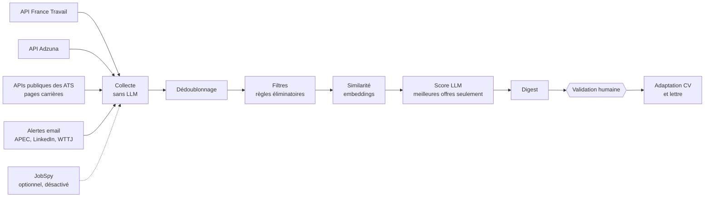

# Vigie

[](https://github.com/HLeviel/vigie/actions/workflows/ci.yml)
[](LICENSE)
[](pyproject.toml)

**Un copilote IA de recherche d'emploi pour le marché français : il surveille les offres et ne signale que celles qui comptent.**

> **English summary.** Vigie is a job-search copilot for the French market, built as a portfolio project. It is a monorepo of four modules: `radar` (daily job collection from official APIs, no LLM), `match` (three-stage offer/CV scoring with a measured evaluation), `cv` (tailored CV and cover letter, shipped as an Agent Skill) and `agent` (a LangChain agent orchestrating the others, with human approval before any action). **Current status: the repository contains the design only; no module is implemented yet.**

## Origine du nom

Dans un navire, la vigie est le marin posté en haut du mât. Elle surveille l'horizon en continu et ne signale que ce qui mérite l'attention du pont. Le projet reprend ce principe : parcourir beaucoup d'offres, n'en remonter que quelques-unes.

## Le problème

Chercher un poste en France oblige à surveiller plusieurs sources (France Travail, APEC, LinkedIn, Welcome to the Jungle, pages carrières des entreprises), à écarter les doublons et les offres hors sujet, puis à adapter son CV à chaque candidature. Ce travail est répétitif et se fait à la main.

Ce qui distingue Vigie des projets existants :

- **France d'abord.** Les sources, les critères (région, télétravail, type de contrat) et la langue sont pensés pour le marché français.
- **Scoring hybride et évalué.** Règles éliminatoires, puis embeddings, puis LLM sur les meilleures offres seulement. La qualité est mesurée (precision@k sur un jeu d'offres annotées), pas supposée.
- **Déploiement serverless.** Collecte planifiée par GitHub Actions, puis migration vers AWS (Lambda, EventBridge, DynamoDB).

## Architecture



La collecte, le dédoublonnage et les filtres appartiennent à `radar`. Les trois étages de score appartiennent à `match`. Le digest est la sortie quotidienne ; l'`agent` orchestre l'ensemble et demande une validation humaine avant toute action.

## Modules

Spécifications : module `radar` : [`docs/specs/radar.md`](docs/specs/radar.md) ; module `match` : [`docs/specs/match.md`](docs/specs/match.md).

| Module | Rôle | Statut |
|---|---|---|
| `radar` | Veille quotidienne des offres, sans LLM | Lots M1 et M2 implémentés ; exécution réelle vérifiée le 24/11/2026 (dépôt privé `vigie-run`, digest reçu, état S3 relu à l'exécution suivante). Alertes email : France Travail vérifié, APEC, WTTJ et LinkedIn non (#16). API France Travail : en attente d'accès (#19) |
| `match` | Score offre/profil en étages (règles, embeddings, LLM), évaluation precision@k | En cours : étapes 1 à 8 : profil, `vigie match check`, score hybride explicable, fournisseurs d'embeddings `local` et `bedrock`, intégré à `radar run` et au digest (tri par score, code de sortie 6), annotation (`vigie match label`, en interactif ou par fichier CSV dans un tableur, avec trois workflows pour `vigie-run`) et évaluation (`vigie match eval`, rapport Markdown + SVG). Jamais exécuté pour de vrai : aucune offre réelle n'est encore annotée, donc aucun rapport réel ; fournisseurs testés avec des doubles. L'étage LLM (réévaluation des meilleures offres via OpenRouter, modèle choisi par la configuration) est écrit et testé avec un faux serveur mais **n'a jamais été exécuté contre le vrai service** et n'est pas évalué : il reste désactivé tant que `hybrid+llm` n'a pas prouvé un gain |
| `cv` | CV et lettre adaptés, packagés en Agent Skill | Prévu |
| `agent` | Agent LangChain, validation humaine avant action | Prévu |

Seul `radar` est implémenté ; `match`, `cv` et `agent` sont prévus. Le détail de ce qui est vérifié ou non est dans la [spécification](docs/specs/radar.md) et dans les issues étiquetées `à-vérifier`.

## Démarrage rapide

> **En cours.** Seul `radar` est partiellement utilisable (collecte Adzuna, stockage, filtres). `match` n'a pour l'instant que son profil et la commande `vigie match check` (pas encore de score) ; `cv` et `agent` n'existent pas.

```bash
git clone https://github.com/HLeviel/vigie.git
cd vigie
uv sync
cp .env.example .env
```

Variables d'environnement (voir [`.env.example`](.env.example)) :

| Variable | Usage |
|---|---|
| `FT_CLIENT_ID`, `FT_CLIENT_SECRET`, `FT_SCOPE` (facultatif) | API France Travail |
| `ADZUNA_APP_ID`, `ADZUNA_APP_KEY` | API Adzuna (lot M2) |
| `IMAP_HOST`, `IMAP_USER`, `IMAP_PASSWORD`, `IMAP_FOLDER` | Lecture des alertes email, en lecture seule (mot de passe d'application) |
| `SMTP_HOST`, `SMTP_PORT`, `SMTP_USER`, `SMTP_PASSWORD`, `DIGEST_TO` | Envoi du digest (lot M2) |
| `VIGIE_STATE_BUCKET` | Bucket S3 privé de l'état (lot M2) |

Les secrets sont lus uniquement par `src/vigie/settings.py`. Le squelette de ce chargement existe ; le reste de `radar` reste à écrire.

Lancement de `radar` (voir `config/radar.example.yaml` pour la configuration) :

```bash
uv run vigie radar check --config config/radar.yaml
uv run vigie radar run --config config/radar.yaml --dry-run
uv run vigie radar stats
uv run vigie radar digest --config config/radar.yaml   # écrit digest.html (ou .md), jamais sur la console
```

`check` ne fait aucun appel réseau. `run --dry-run` collecte sans rien écrire. `digest` écrit les nouveautés dans un fichier privé (mode 0600, ignoré par git). `run` envoie aussi le digest par email si les variables SMTP sont définies (`--no-email` pour l'éviter), et synchronise l'état avec S3 si `VIGIE_STATE_BUCKET` l'est.

## Exécution planifiée : code public, exécution privée

Ce dépôt est **public** : il contient le code, les tests, la CI et des données **fictives**, et il n'a **aucun secret**. L'exécution réelle (vrais critères, vraies entreprises ciblées, CV, secrets, état, logs) a lieu dans un dépôt **privé** `vigie-run`, qui ne contient pas de code Python : son workflow installe une **version taguée** de Vigie (`uv tool install "git+https://github.com/HLeviel/vigie@vX.Y.Z"`, jamais `main`) puis lance `vigie radar run`, qui collecte, envoie le digest par email et synchronise l'état avec un bucket S3 privé. Authentification AWS par OIDC : aucune clé stockée.

- Modèle du dépôt privé, pas à pas (bucket S3, rôle IAM, environnement GitHub `radar`, secrets) : [`examples/vigie-run/`](examples/vigie-run/README.md).
- Publier une version : mettre à jour `version` dans `pyproject.toml`, puis pousser un tag `vX.Y.Z` ; [`release.yml`](.github/workflows/release.yml) relance la CI, vérifie que le tag correspond à la version du paquet, puis crée la release avec son journal des changements.
- Sécurité et fuite de secret : [`SECURITY.md`](SECURITY.md).

Codes de sortie de `run` : `0` succès, `1` erreur de configuration ou de secrets, `2` toutes les sources ont échoué, `3` au moins une source a échoué, `4` envoi du digest échoué, `5` état S3 inaccessible ou non synchronisé.

## Choix techniques

- **APIs officielles plutôt que scraping.** Stables, autorisées, sans risque de blocage ni de non-conformité aux conditions d'utilisation. JobSpy n'est qu'une option, désactivée par défaut.
- **Pas de LLM à la collecte.** La collecte est déterministe, peu coûteuse et reproductible. Le LLM n'intervient qu'en fin de chaîne, sur un petit nombre d'offres.
- **État stocké hors du cache GitHub Actions.** Le cache peut être évincé ; l'historique des offres vues ne doit pas l'être. L'état vit dans un bucket S3 privé (base SQLite, écriture conditionnelle).
- **Annonces traitées comme entrée potentiellement malveillante.** Le texte d'une offre est une donnée non fiable : il est nettoyé et délimité avant d'atteindre le LLM, pour limiter les injections de prompt.
- **Garde-fou sur le CV.** Aucune ligne générée sans source dans le CV de référence.

## Données personnelles

Le dépôt public utilise uniquement un **profil fictif**. Le vrai CV et les digests restent privés et ne sont jamais committés.

**Étage LLM (optionnel, désactivé par défaut)** : quand il est activé dans `vigie-run`, une version nettoyée du profil (sans noms d'entreprise ni dates) et le texte des offres évaluées transitent par **OpenRouter** puis par le fournisseur du modèle choisi. Chaque requête demande `data_collection: "deny"` ; vérifie aussi les réglages de confidentialité de ton compte OpenRouter et la politique du fournisseur avant activation.

## Compétences mises en œuvre

Python, GitHub Actions, AWS (Lambda, EventBridge, DynamoDB), RAG, embeddings, agents LangChain, Claude Code, Agent Skills, GitHub Copilot.

Ces compétences sont l'objectif du projet ; elles seront démontrées module par module au fil de l'implémentation.

## Feuille de route

1. `radar` : collecte France Travail et Adzuna, dédoublonnage, GitHub Actions.
2. `radar` : ATS publics, alertes email, puis AWS (Lambda, EventBridge, DynamoDB).
3. `match` : filtres, embeddings, score LLM, jeu annoté et precision@k.
4. `cv` : Agent Skill avec garde-fou de source.
5. `agent` : orchestration LangChain avec validation humaine.

## Licence

[MIT](LICENSE).

## Auteur

Hubert Leviel, [@HLeviel](https://github.com/HLeviel).
